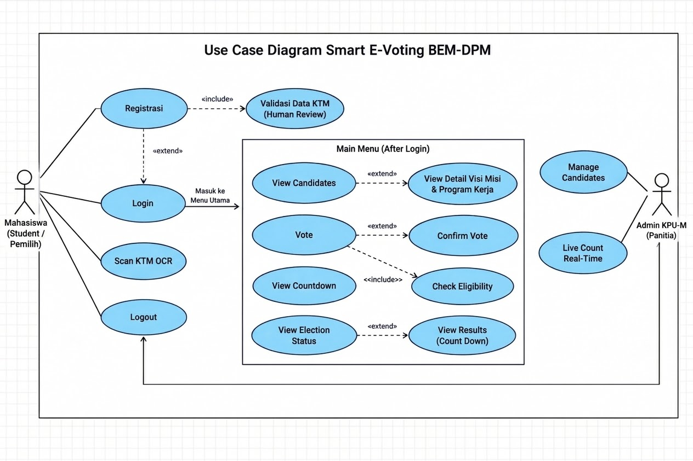
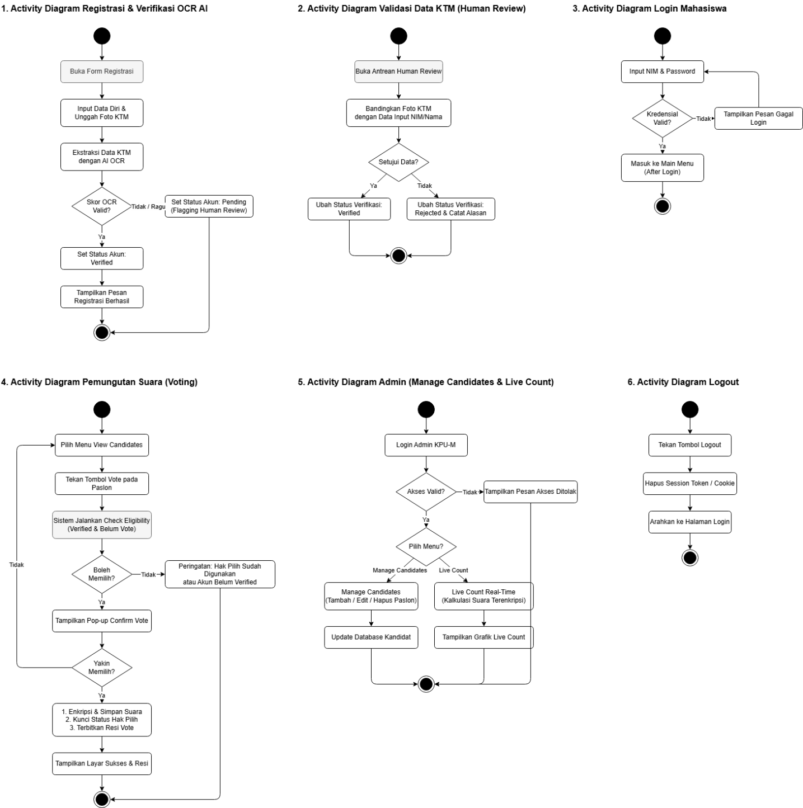
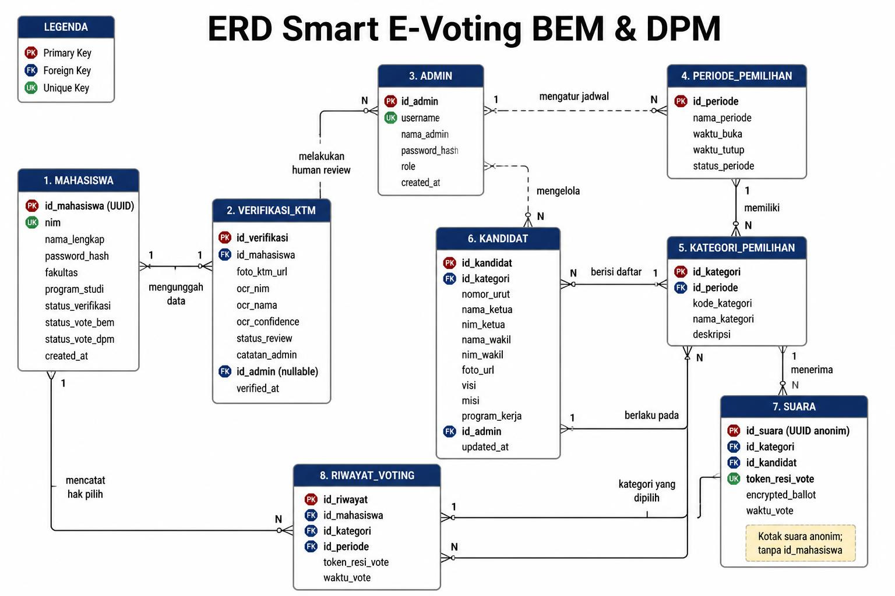

# 08 — System Design & Arsitektur Sistem

**Proyek:** Smart E-Voting BEM-DPM  
**Kelompok:** 1  

---

## 1. Arsitektur Perangkat Lunak Tingkat Tinggi (High-Level Architecture)

Aplikasi dirancang menggunakan arsitektur *Client-Server* modern berbasis RESTful API:

```text
┌────────────────────────────────────────────────────────────────────────┐
│                        KLIEN / FRONTEND LAYER                          │
│                                                                        │
│   ┌─────────────────────────────┐    ┌─────────────────────────────┐   │
│   │   Flutter Mobile App        │    │   Flutter Web / PWA         │   │
│   │   (Android & iOS)           │    │   (Desktop & Safari iOS)    │   │
│   └──────────────┬──────────────┘    └──────────────┬──────────────┘   │
└──────────────────┼──────────────────────────────────┼──────────────────┘
                   │ HTTPS / JSON Web Token (JWT)     │
                   ▼                                  ▼
┌────────────────────────────────────────────────────────────────────────┐
│                        BACKEND & LAYANAN API                           │
│                                                                        │
│   ┌────────────────────────────────────────────────────────────────┐   │
│   │   REST API Gateway & Security Guard                            │   │
│   │   - Rate Limiting & Account Lockout (5x fail -> 15 min lock)   │   │
│   │   - Session Expiration (15 min idle) & 2FA Admin Handler       │   │
│   │   - Idempotency Key & ACID Voting Transaction Manager          │   │
│   └───────┬────────────────────────────┬───────────────────┬───────┘   │
│           │                            │                   │           │
│           ▼                            ▼                   ▼           │
│   ┌─────────────────┐        ┌─────────────────┐ ┌─────────────────┐   │
│   │  Core Voting    │        │  AI OCR Engine  │ │  Admin Panel &  │   │
│   │  Engine         │        │  (Vision API)   │ │  Live Count     │   │
│   └───────┬─────────┘        └─────────────────┘ └─────────┬───────┘   │
└───────────┼────────────────────────────────────────────────┼───────────┘
            │                                                │
            ▼                                                ▼
┌────────────────────────────────────────────────────────────────────────┐
│                         LAPISAN BASIS DATA                             │
│                                                                        │
│   ┌───────────────────────────┐        ┌───────────────────────────┐   │
│   │   Tabel Identitas & Audit │        │   Kotak Suara Terenkripsi │   │
│   │   - MAHASISWA             │        │   - SUARA (UUID Anonim,   │   │
│   │   - VERIFIKASI_KTM        │        │     encrypted_ballot,     │   │
│   │   - RIWAYAT_VOTING        │        │     TANPA id_mahasiswa!)  │   │
│   │   - ADMIN & AUDIT_LOG     │        └───────────────────────────┘   │
│   └───────────────────────────┘                                        │
└────────────────────────────────────────────────────────────────────────┘
```

---

## 2. Diagram Use Case (Kasus Penggunaan)

Sistem memiliki dua aktor utama: **Mahasiswa (Student / Pemilih)** dan **Admin KPU-M (Panitia)**.



### Karakteristik Use Case:
- **`Registrasi`**: Mengunggah data diri dan foto KTM, terhubung dengan `<<include>>` ke **Validasi Data KTM (Human Review)** serta relasi `<<extend>>` ke **Login**.
- **`Login`**: Menghubungkan pemilih ke **Main Menu (After Login)** setelah verifikasi kredensial berhasil.
- **`Main Menu` Box**: Membungkus kasus penggunaan inti pemilih:
  - `View Candidates` ──`<<extend>>`──► `View Detail Visi Misi & Program Kerja`
  - `Vote` ──`<<include>>`──► `Check Eligibility` (memverifikasi akun `Verified` dan belum pernah memilih)
  - `Vote` ──`<<extend>>`──► `Confirm Vote` (pop-up dialog konfirmasi)
  - `View Countdown` & `View Election Status` ──`<<extend>>`──► `View Results (Count Down)`
- **Aktor Admin KPU-M**: Memiliki hak mengelola data paslon (`Manage Candidates`) dan memantau perolehan suara (`Live Count Real-Time`).

---

## 3. Diagram Aktivitas (Activity Diagrams)

Terdapat 6 alur proses aktivitas utama sistem yang direkayasa untuk menjamin keamanan dan kenyamanan pengguna:



### Rincian 6 Alur Aktivitas:
1. **Activity 1: Registrasi & Verifikasi OCR AI**: Mahasiswa mengunggah data dan foto KTM. AI OCR mengekstrak data. Jika skor valid (>=85%), status diset `Verified`; jika skor rendah/ragu, diset `Pending` dan diflagging ke antrean Human Review.
2. **Activity 2: Validasi Data KTM (Human Review)**: Admin membuka antrean, memeriksa dan memperbesar foto KTM, lalu memutuskan `Verified` atau `Rejected` (+ alasan wajib).
3. **Activity 3: Login Mahasiswa**: Pengecekan NIM & kata sandi, perlindungan lockout 5x percobaan gagal, dan pengecekan status akun sebelum diarahkan ke Main Menu.
4. **Activity 4: Pemungutan Suara (Voting)**: Pemilih menekan tombol paslon -> Sistem menjalankan *Check Eligibility* -> Jika lolos, muncul pop-up konfirmasi -> Jika dikonfirmasi, sistem mengenkripsi suara, mengunci hak pilih, menerbitkan resi vote, dan menampilkan layar sukses.
5. **Activity 5: Admin Panel (Manage Candidates & Live Count)**: Admin login -> Memilih menu kelola paslon (CRUD) atau pantau *Live Count Real-Time*.
6. **Activity 6: Logout**: Pembersihan token sesi dari Secure Storage dan pengalihan kembali ke layar autentikasi awal.

---

## 4. Entity Relationship Diagram (ERD) & Kamus Data

Struktur basis data dirancang dengan 8 entitas untuk memisahkan secara ketat antara identitas pemilih dan pilihan suara:



### Matriks Relasi Antar Entitas:
1. `ADMIN` (1) ── (N) `VERIFIKASI_KTM` : Admin melakukan peninjauan manual KTM yang ragu.
2. `ADMIN` (1) ── (N) `KANDIDAT` : Admin menginput dan memperbarui data paslon.
3. `ADMIN` (1) ── (N) `PERIODE_PEMILIHAN` : Admin mengatur jam buka/tutup TPS digital.
4. `PERIODE_PEMILIHAN` (1) ── (N) `KATEGORI_PEMILIHAN` : Satu pemilu memiliki kategori BEM dan DPM.
5. `KATEGORI_PEMILIHAN` (1) ── (N) `KANDIDAT` : Kategori BEM/DPM memuat daftar paslon terkait.
6. `MAHASISWA` (1) ── (1) `VERIFIKASI_KTM` : Satu mahasiswa mengunggah satu bukti kartu identitas.
7. `MAHASISWA` (1) ── (N) `RIWAYAT_VOTING` : Mencatat hak pilih yang telah dipakai per kategori.
8. `KATEGORI_PEMILIHAN` (1) ── (N) `SUARA` : Kategori menerima kertas suara digital.
9. `KANDIDAT` (1) ── (N) `SUARA` : Paslon menerima akumulasi suara.
10. `SUARA` **TIDAK MEMILIKI RELASI** ke `MAHASISWA` (Menjamin asas kerahasiaan suara pemilu).

---

## 5. Protokol Keamanan & Kerahasiaan Pemilu (Luber Jurdil)

1. **Prinsip Kotak Suara Terpisah (Secret Ballot Isolation):**
   - Tabel `SUARA` menyimpan surat suara menggunakan primary key UUID acak, payload `encrypted_ballot`, dan `token_resi_vote`. Kolom `id_mahasiswa` sengaja ditiadakan.
   - Pihak pengelola database atau admin tidak memiliki kemampuan query untuk mengetahui siapa memilih siapa.
2. **Pencegahan Suara Ganda (*Anti Double-Voting*):**
   - Pengecekan status memilih dilakukan sebelum transaksi melalui flag `status_vote_bem` dan `status_vote_dpm` pada tabel `MAHASISWA`.
   - Transaksi database menerapkan constraint `UNIQUE(id_mahasiswa, id_kategori, id_periode)` pada tabel `RIWAYAT_VOTING`.
3. **Penerbitan Resi Vote (Receipt Verification):**
   - Pemilih menerima hash token unik pada layar konfirmasi sukses sebagai tanda terima bahwa suara telah sah dihitung, tanpa mencetak nama paslon yang dipilih (mencegah praktik jual beli suara / paksaan pihak luar).
4. **Pembatasan Data Live Count (Aggregated Guard):**
   - Selama status TPS bernilai `AKTIF`, API hanya mengembalikan total kuorum suara masuk. Rincian persentase dan pemenang per paslon baru dapat di-query setelah periode TPS resmi berubah menjadi `DITUTUP`.
