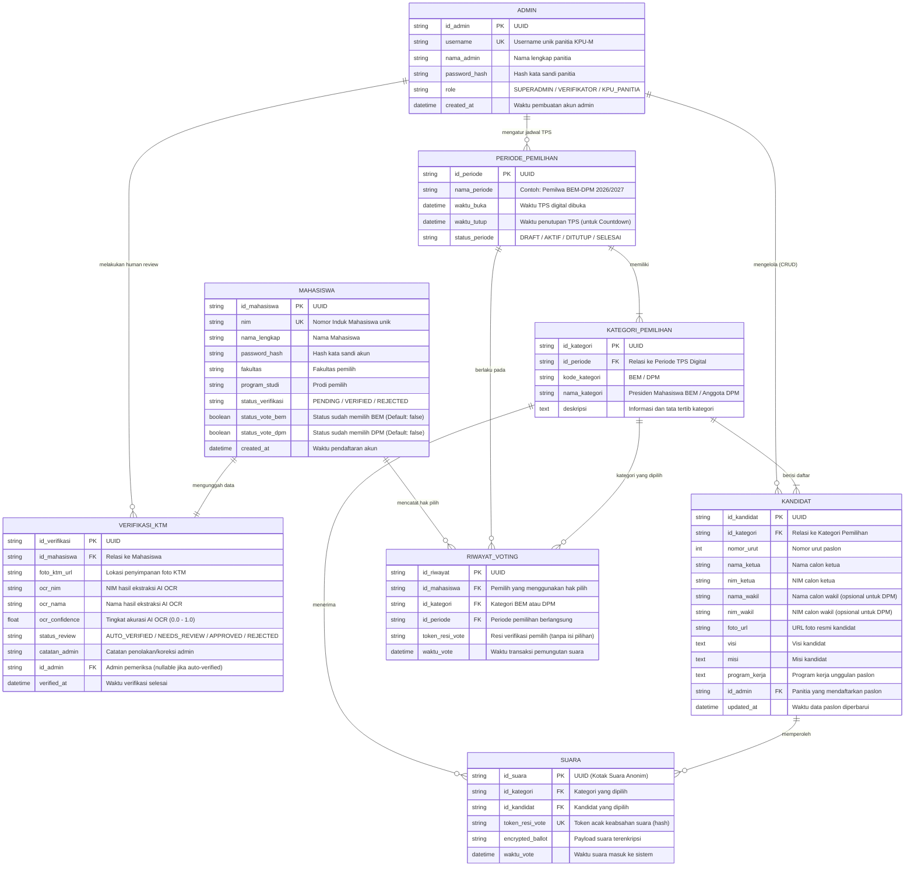

# Perancangan Basis Data (Entity Relationship Diagram)
## Sistem Smart E-Voting BEM & DPM

Dokumen ini menjelaskan struktur data dan rancangan *Entity Relationship Diagram* (ERD) yang diturunkan dari dokumen perencanaan, diagram *use case*, dan *activity diagram* sistem Smart E-Voting BEM & DPM.

---

### 1. Diagram ERD (Mermaid)

---

### 2. Kamus Data (Data Dictionary)

#### A. Entitas `MAHASISWA`
Menyimpan identitas mahasiswa aktif yang memiliki hak suara dalam pemilu.
* `id_mahasiswa` (UUID, Primary Key): Pengenal unik akun mahasiswa.
* `nim` (VARCHAR(20), Unique): Nomor Induk Mahasiswa untuk autentikasi.
* `nama_lengkap` (VARCHAR(150)): Nama resmi mahasiswa sesuai data akademik.
* `password_hash` (VARCHAR(255)): Hash kata sandi terenkripsi (misal: bcrypt / Argon2).
* `fakultas` (VARCHAR(100)): Asal fakultas pemilih.
* `program_studi` (VARCHAR(100)): Program studi pemilih.
* `status_verifikasi` (ENUM: `'PENDING'`, `'VERIFIED'`, `'REJECTED'`): Status validasi akun pemilih.
* `status_vote_bem` (BOOLEAN, default: `false`): Penanda apakah pemilih sudah mencoblos BEM.
* `status_vote_dpm` (BOOLEAN, default: `false`): Penanda apakah pemilih sudah mencoblos DPM.
* `created_at` (DATETIME): Waktu akun dibuat.

#### B. Entitas `VERIFIKASI_KTM`
Menangani alur verifikasi identitas berbasis OCR AI dan peninjauan manusia (*human review*).
* `id_verifikasi` (UUID, Primary Key): Pengenal unik sesi verifikasi KTM.
* `id_mahasiswa` (UUID, Foreign Key): Referensi ke mahasiswa terkait (relasi 1-to-1).
* `foto_ktm_url` (VARCHAR(255)): Path berkas foto KTM yang diunggah.
* `ocr_nim` (VARCHAR(20)): NIM yang terbaca oleh sistem OCR AI.
* `ocr_nama` (VARCHAR(150)): Nama yang terbaca oleh sistem OCR AI.
* `ocr_confidence` (FLOAT): Tingkat keyakinan OCR (0.00 hingga 1.00).
* `status_review` (ENUM: `'AUTO_VERIFIED'`, `'NEEDS_REVIEW'`, `'APPROVED'`, `'REJECTED'`): Status peninjauan verifikasi.
* `catatan_admin` (TEXT, Nullable): Catatan jika foto buram, data tidak sinkron, atau ditolak.
* `id_admin` (UUID, Foreign Key, Nullable): Admin KPU-M yang melakukan persetujuan manual jika status `NEEDS_REVIEW`.
* `verified_at` (DATETIME, Nullable): Waktu status verifikasi disahkan.

#### C. Entitas `ADMIN`
Menampung kredensial dan hak akses panitia pemilihan (KPU-M).
* `id_admin` (UUID, Primary Key): Pengenal unik akun panitia.
* `username` (VARCHAR(50), Unique): Username untuk login admin.
* `nama_admin` (VARCHAR(100)): Nama lengkap panitia.
* `password_hash` (VARCHAR(255)): Hash kata sandi akun admin.
* `role` (ENUM: `'SUPERADMIN'`, `'VERIFIKATOR'`, `'KPU_PANITIA'`): Peran kewenangan di sistem.
* `created_at` (DATETIME): Waktu akun admin dibuat.

#### D. Entitas `PERIODE_PEMILIHAN`
Menyimpan konfigurasi jadwal TPS Digital untuk mendukung fitur hitung mundur (*countdown*).
* `id_periode` (UUID, Primary Key): Pengenal unik periode pemilu.
* `nama_periode` (VARCHAR(100)): Nama agenda (misal: "Pemilwa Raya 2026").
* `waktu_buka` (DATETIME): Waktu mulainya pemungutan suara.
* `waktu_tutup` (DATETIME): Batas akhir pemungutan suara (penentu *countdown* TPS digital).
* `status_periode` (ENUM: `'DRAFT'`, `'AKTIF'`, `'DITUTUP'`, `'SELESAI'`): Status operasional TPS.

#### E. Entitas `KATEGORI_PEMILIHAN`
Memfasilitasi pemilihan berjenjang (BEM dan DPM).
* `id_kategori` (UUID, Primary Key): Pengenal unik kategori pemilihan.
* `id_periode` (UUID, Foreign Key): Terhubung ke agenda pemilu tertentu.
* `kode_kategori` (VARCHAR(20)): Kode penanda unik (`'BEM'`, `'DPM'`).
* `nama_kategori` (VARCHAR(100)): Label tampilan (misal: "Pemilihan Paslon Ketua & Wakil BEM").
* `deskripsi` (TEXT): Petunjuk khusus pemilihan untuk kategori ini.

#### F. Entitas `KANDIDAT`
Menyimpan informasi kandidat/paslon yang dikelola oleh Admin KPU-M.
* `id_kandidat` (UUID, Primary Key): Pengenal unik kandidat.
* `id_kategori` (UUID, Foreign Key): Terhubung ke kategori pemilihan terkait.
* `nomor_urut` (INT): Nomor urut resmi paslon pada surat suara.
* `nama_ketua` (VARCHAR(150)): Nama calon ketua.
* `nim_ketua` (VARCHAR(20)): NIM calon ketua.
* `nama_wakil` (VARCHAR(150), Nullable): Nama calon wakil (nullable untuk calon perorangan DPM).
* `nim_wakil` (VARCHAR(20), Nullable): NIM calon wakil.
* `foto_url` (VARCHAR(255)): URL foto resmi paslon.
* `visi` (TEXT): Pernyataan visi kandidat.
* `misi` (TEXT): Poin-poin misi kandidat.
* `program_kerja` (TEXT): Penjelasan program kerja unggulan.
* `id_admin` (UUID, Foreign Key): ID admin yang menginput/memperbarui data paslon.
* `updated_at` (DATETIME): Waktu data paslon terakhir disunting.

#### G. Entitas `SUARA` (Kotak Suara Terenkripsi / Ballot Box)
Menyimpan pilihan suara yang masuk secara terenkripsi dan terpisah dari identitas pemilih.
* `id_suara` (UUID, Primary Key): Pengenal acak surat suara digital.
* `id_kategori` (UUID, Foreign Key): Kategori pemilihan suara tersebut.
* `id_kandidat` (UUID, Foreign Key): Kandidat yang dicoblos.
* `token_resi_vote` (VARCHAR(64), Unique): Kode acak terenkripsi sebagai nomor bukti sah.
* `encrypted_ballot` (TEXT): Payload suara yang dienkripsi secara kriptografis.
* `waktu_vote` (DATETIME): Timestamp saat suara masuk (digunakan untuk agregasi *Live Count Real-Time*).

#### H. Entitas `RIWAYAT_VOTING` (Audit Log Pemilih)
Menjamin asas anti suara ganda (*prevent double voting*) dan menerbitkan resi pemilihan kepada mahasiswa.
* `id_riwayat` (UUID, Primary Key): Pengenal log partisipasi.
* `id_mahasiswa` (UUID, Foreign Key): Identitas mahasiswa yang telah menunaikan hak pilih.
* `id_kategori` (UUID, Foreign Key): Kategori yang telah dicoblos pemilih.
* `id_periode` (UUID, Foreign Key): Periode pemilu terkait.
* `token_resi_vote` (VARCHAR(64)): Hash resi yang ditampilkan pada layar mahasiswa sebagai bukti berhasil memilih (tanpa menyimpan nama paslon yang dipilih).
* `waktu_vote` (DATETIME): Waktu transaksi pemilihan.

---

### 3. Arsitektur Keamanan & Kerahasiaan Pemilu (LUBER-JURDIL)

1. **Pemisahan Data Pemilih dan Pilihan Suara (Anonimitas)**:
   - Sesuai prinsip *Secret Ballot*, tabel `SUARA` sama sekali tidak memiliki kolom `id_mahasiswa`.
   - Admin atau pihak manapun yang menginspeksi database tidak dapat melacak paslon yang dipilih oleh seorang mahasiswa tertentu.
2. **Pencegahan Suara Ganda (*Anti Double-Voting*)**:
   - Pengecekan dilakukan berlapis: melalui flag `status_vote_bem`/`status_vote_dpm` pada tabel `MAHASISWA`, serta pembatasan *constraint* kombinasi unik `(id_mahasiswa, id_kategori, id_periode)` pada tabel `RIWAYAT_VOTING`.
3. **Resi Pemilihan (Receipt-Free Verification)**:
   - Mahasiswa menerima `token_resi_vote` setelah menekan konfirmasi pilihan suara. Token ini berfungsi sebagai tanda bukti bahwa suara telah tercatat di sistem tanpa mencantumkan nama kandidat, menjaga kerahasiaan pilihan dari potensi paksaan (*coercion resistance*).
4. **Agregasi Live Count Real-Time**:
   - Fitur *Live Count* pada dashboard Admin KPU-M melakukan kueri agregasi (`COUNT`) langsung ke tabel `SUARA` yang dikelompokkan berdasarkan `id_kandidat` tanpa membaca data pribadi pemilih.

